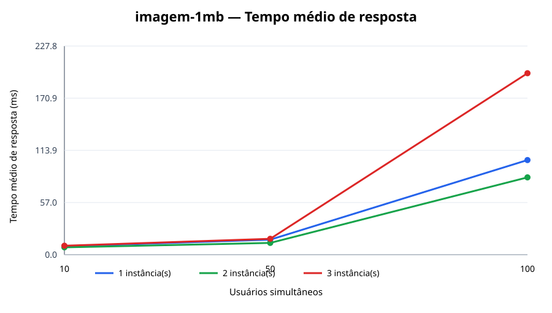
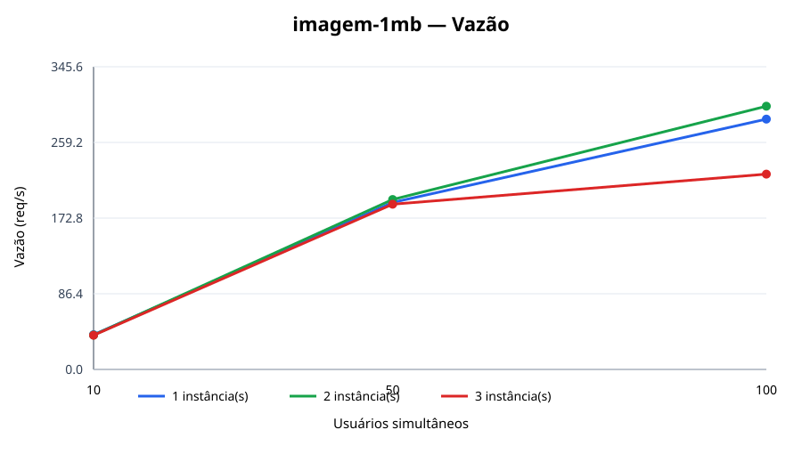
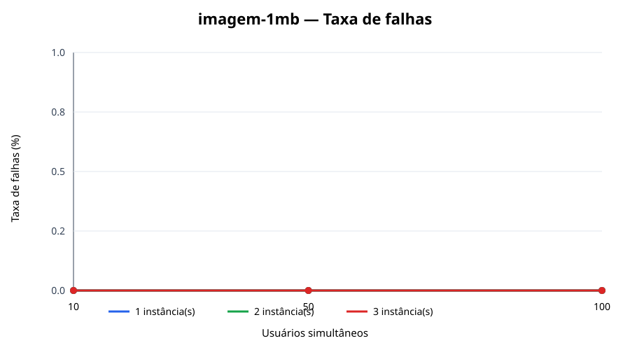
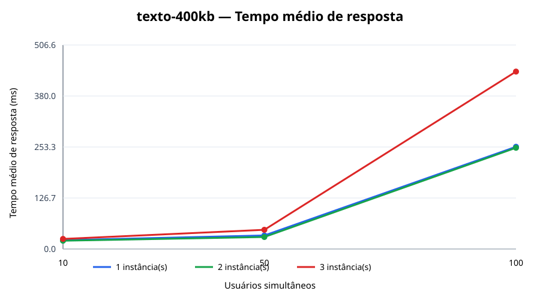
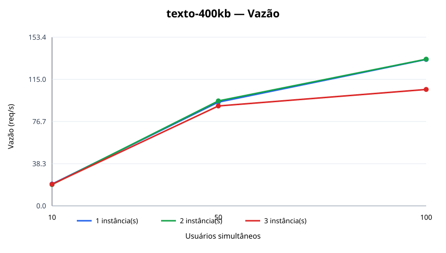
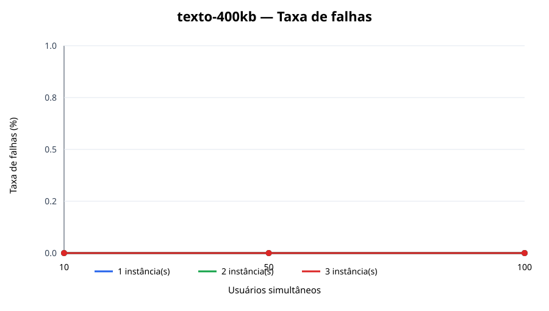
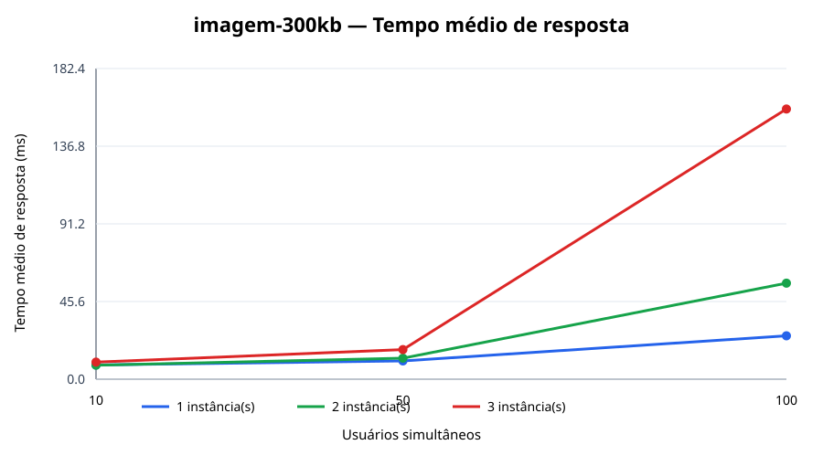
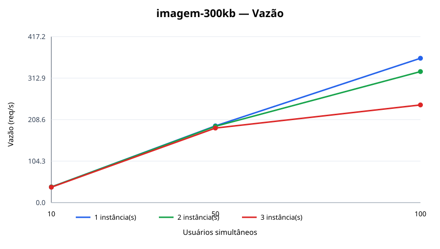

# Resultados medidos

Os [27 testes](resumo.csv) foram executados no [GitHub Actions](https://github.com/JoaoGustavoNobreGois/wordpress-docker-trabalhos/actions/runs/39129772402) em 18/10/2026. A execução usou 10, 50 e 100 usuários simultâneos, 1, 2 e 3 instâncias WordPress, três tipos de publicação e 30 segundos por combinação. Os contêineres e o Locust compartilharam o mesmo runner Ubuntu.

Foram registradas **111.531 requisições e nenhuma falha**. O arquivo [resumo.csv](resumo.csv) contém todas as combinações, inclusive mediana, p95 e tamanho médio da resposta. Os [CSVs brutos](raw/) e o [manifesto](runs.json) permitem conferir as medições.

## Comparação com 100 usuários

| Cenário | WordPress | Tempo médio (ms) | p95 (ms) | Requisições/s | Falhas |
| --- | ---: | ---: | ---: | ---: | ---: |
| Imagem de 1 MB | 1 | 103,347 | 280 | 285,769 | 0 |
| Imagem de 1 MB | 2 | 84,410 | 280 | 300,479 | 0 |
| Imagem de 1 MB | 3 | 198,106 | 580 | 223,020 | 0 |
| Texto de 400 KB | 1 | 253,932 | 420 | 133,159 | 0 |
| Texto de 400 KB | 2 | 251,364 | 460 | 133,384 | 0 |
| Texto de 400 KB | 3 | 440,558 | 950 | 105,881 | 0 |
| Imagem de 300 KB | 1 | 25,477 | 90 | 362,811 | 0 |
| Imagem de 300 KB | 2 | 56,401 | 200 | 329,388 | 0 |
| Imagem de 300 KB | 3 | 158,638 | 470 | 245,561 | 0 |

Nesta execução, duas instâncias melhoraram ligeiramente o caso da imagem de 1 MB com 100 usuários. Três instâncias tiveram menor vazão e maior tempo médio nos três cenários com 100 usuários. Uma causa possível é a competição por CPU, memória e banco de dados no mesmo runner; os testes não isolam essa causa. Estes números descrevem somente o ambiente medido.

O Locust solicita página e imagem em duas requisições nos cenários de imagem. No cenário de texto, cada tarefa faz uma requisição. Por isso, a vazão em requisições/s deve ser comparada junto com o tipo de cenário.

## Gráficos

O eixo X representa o número de usuários; as três linhas representam 1, 2 e 3 instâncias WordPress.

### Imagem de 1 MB

### Texto de 400 KB

### Imagem de 300 KB

