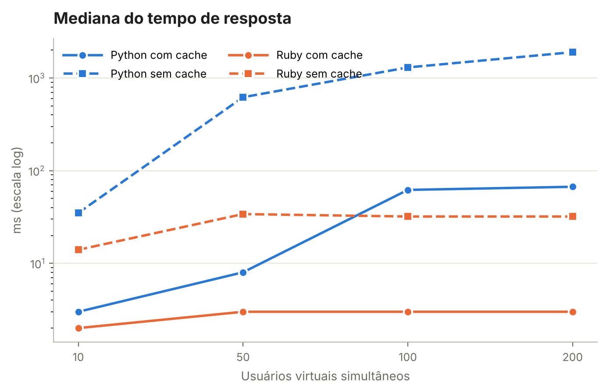
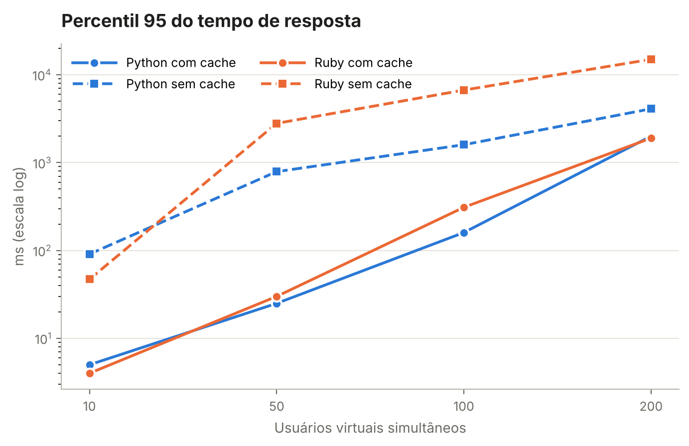
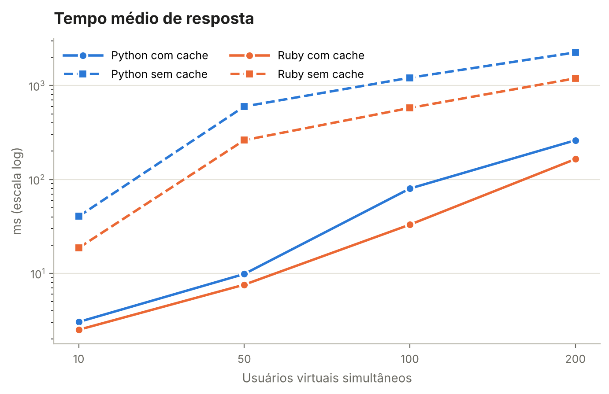
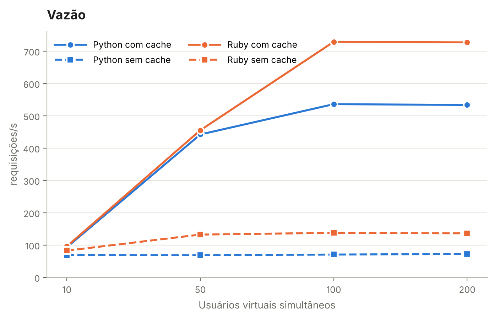
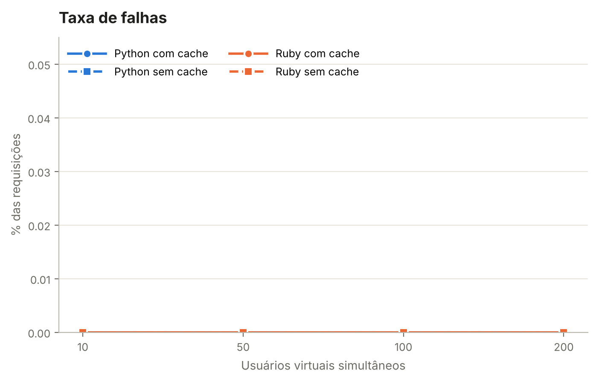
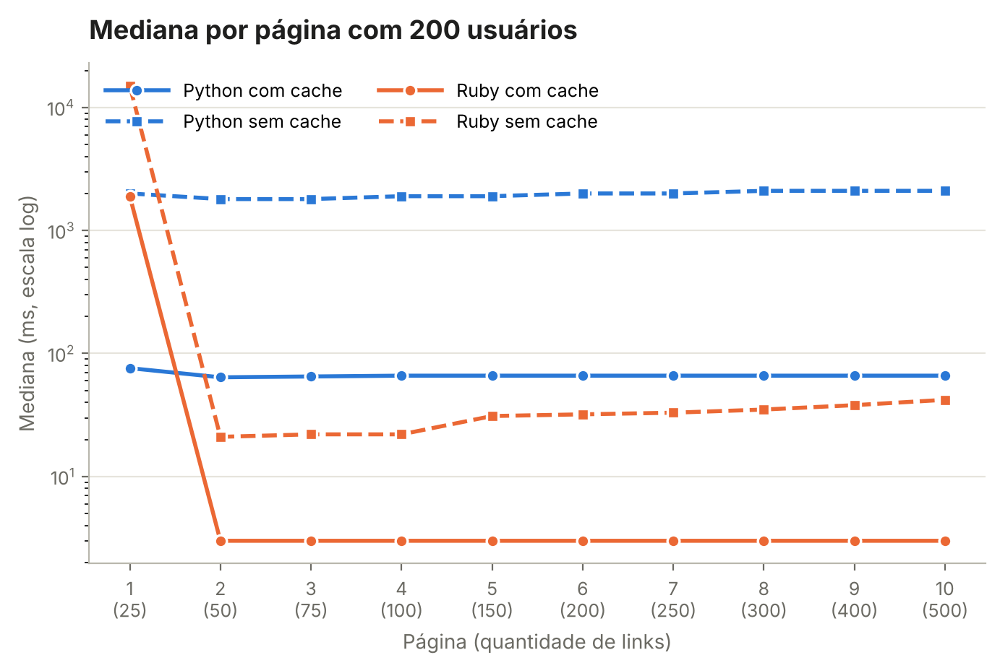

# Resultados medidos

Os 16 testes foram executados em 03/11/2026, 60 s cada, numa VM Linux com 2 vCPUs (Intel Xeon 2,1 GHz) e 8 GB de RAM, com Locust 2.47.0. Os serviços rodaram como processos locais (`run_matrix.py --local`), com o mesmo código dos contêineres; Locust e serviços dividiram as mesmas 2 vCPUs. Foram **267.385 requisições e nenhuma falha**.

- [resumo.csv](resumo.csv): uma linha por teste, com média, mediana, p90, p95, p99, máximo, requisições/s e falhas.
- [raw/](raw/): CSVs exportados pelo Locust (estatísticas por página, histórico por segundo, falhas e exceções).
- [runs.json](runs.json): parâmetros e horário de cada teste.

## Resumo

| Versão | Cache | Usuários | Média (ms) | Mediana (ms) | p95 (ms) | p99 (ms) | Req/s | Falhas |
| --- | --- | ---: | ---: | ---: | ---: | ---: | ---: | ---: |
| Python | com | 10 | 3,0 | 3 | 5 | 8 | 93,2 | 0 |
| Python | com | 50 | 9,9 | 8 | 25 | 37 | 442,2 | 0 |
| Python | com | 100 | 80,0 | 62 | 160 | 510 | 536,0 | 0 |
| Python | com | 200 | 261,5 | 67 | 2.000 | 3.200 | 533,5 | 0 |
| Ruby | com | 10 | 2,5 | 2 | 4 | 7 | 96,0 | 0 |
| Ruby | com | 50 | 7,6 | 3 | 30 | 120 | 455,2 | 0 |
| Ruby | com | 100 | 33,0 | 3 | 310 | 480 | 729,0 | 0 |
| Ruby | com | 200 | 164,9 | 3 | 1.900 | 2.200 | 727,2 | 0 |
| Python | sem | 10 | 40,5 | 35 | 91 | 120 | 69,0 | 0 |
| Python | sem | 50 | 598,6 | 620 | 790 | 860 | 68,6 | 0 |
| Python | sem | 100 | 1.211,5 | 1.300 | 1.600 | 1.800 | 70,5 | 0 |
| Python | sem | 200 | 2.252,8 | 1.900 | 4.100 | 6.700 | 72,5 | 0 |
| Ruby | sem | 10 | 18,7 | 14 | 47 | 77 | 82,8 | 0 |
| Ruby | sem | 50 | 262,1 | 34 | 2.800 | 3.200 | 132,3 | 0 |
| Ruby | sem | 100 | 577,8 | 32 | 6.700 | 7.700 | 137,8 | 0 |
| Ruby | sem | 200 | 1.193,6 | 32 | 15.000 | 17.000 | 136,2 | 0 |

## Leitura

- **O cache é o fator dominante.** Com 10 usuários, a mediana cai de 35 para 3 ms (Python) e de 14 para 2 ms (Ruby). A vazão máxima sobe de ~70 para ~535 req/s em Python e de ~137 para ~729 req/s em Ruby. Sem cache, cada requisição baixa e analisa a página inteira, e o serviço satura já com 50 usuários.
- **Ruby teve mais vazão nos dois modos**, mas com cauda longa: a mediana fica baixa e o p95/p99 dispara. O [gráfico por página](graficos/mediana-por-pagina-u200.png) mostra que a espera se concentra na **primeira** requisição de cada sequência. Uma explicação provável é o Puma (5 threads por padrão) atender em seguida as requisições de uma mesma conexão: quem já está sendo atendido termina a sequência, e quem chega espera na fila.
- **Python degrada de forma mais uniforme.** Sem cache, todas as páginas ficam perto de 2 s com 200 usuários, porque o tempo é dominado pela fila, não pela quantidade de links.
- Nenhum teste teve falhas: sob sobrecarga, os serviços enfileiraram em vez de recusar requisições. O efeito aparece no tempo de resposta, não na taxa de erro.

Os números descrevem este ambiente (2 vCPUs compartilhadas com o gerador de carga), não um servidor de produção.

## Gráficos

Linha contínua = com cache; tracejada = sem cache. Azul = Python; laranja = Ruby.

